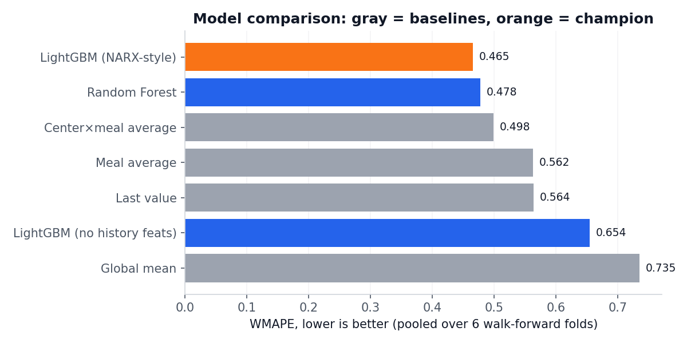
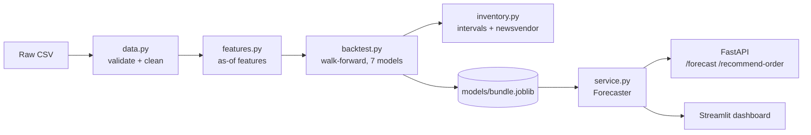

# 🍱 FoodCast: meal-demand forecasting & inventory planning

> Weekly demand forecasts for a meal-delivery network, with **calibrated uncertainty** and a **cost-optimal stock recommendation**, served through a REST API and an interactive dashboard.

**Live demo:** _add your Streamlit Cloud link here_ · **API docs:** `http://localhost:8000/docs`



## The problem

Meal-delivery fulfilment centers prepare perishable ingredients weekly. Forecast too low and orders are lost; too high and food is thrown away. A point forecast alone does not tell a planner how much to stock, so this project goes from **history → forecast → interval → order quantity**.

## Results (walk-forward backtest, 6 folds × 10-week horizon)

| Model | WMAPE ↓ | RMSLE ↓ | Folds beating baseline |
|---|---|---|---|
| Global mean | 0.735 | 1.146 | – |
| Meal average | 0.562 | 0.842 | – |
| **Center×meal average** (planner's baseline) | 0.498 | 0.768 | – |
| Random Forest | 0.478 | 0.705 | 4/6 |
| **LightGBM, NARX-style (champion)** | **0.465** | **0.702** | **6/6** |

* **−6.6% WMAPE** vs the planner baseline and it wins in **every** fold.
* **80% prediction intervals cover 83%** of out-of-sample weeks (calibrated on earlier folds only).
* **Ordering simulation:** same safety-stock treatment for every model → **−9.5% total cost** (waste + lost margin) and **+3.6 pts fill rate** vs the baseline policy. *Under assumed unit economics (40% margin, 25% waste cost); the data has no cost information.*

Honest framing: the bundled data is a **1,999-row sample** (0.9% of all possible center×meal×week cells), so absolute accuracy is modest and gains are incremental, not dramatic. See [docs/model_card.md](docs/model_card.md).

## What makes this different from a typical notebook project

| Concern | How it is handled |
|---|---|
| **Data leakage** | Every history feature uses `merge_asof(..., allow_exact_matches=False)`: strictly earlier weeks only. A unit test mutates future targets and asserts features do not change. |
| **Evaluation** | Walk-forward (rolling-origin) backtest that mirrors production, not a random split. |
| **Baselines** | Four baselines included. A model must beat the planner's simple average to count. |
| **Metrics** | WMAPE and RMSLE. MAPE is deliberately avoided: with small counts it explodes. |
| **Sparse panel** | Only 0.4% of rows have a previous-week row, so fixed lags are useless. The model uses *last observed demand + its age* and smoothed meal/center/pair encodings instead. |
| **Uncertainty** | Empirical residual quantiles from out-of-sample folds (conformal-style); coverage is verified, not assumed. |
| **Decisions** | Newsvendor critical ratio `margin / (margin + waste)` → quantile order quantity. |
| **Engineering** | Package layout, typed API schemas, Docker, CI, 21 tests. |

## Architecture



## Quick start

```bash
pip install -r requirements-dev.txt
python -m fdf.train          # backtest, figures, model bundle (~1 min)
pytest -q                    # 21 tests
uvicorn api.main:app --port 8000     # REST API  -> /docs
streamlit run dashboard/app.py       # dashboard
# or everything: docker compose up --build
```

### API example

```bash
curl -X POST localhost:8000/recommend-order -H 'content-type: application/json' -d '{
  "week": 146, "center_id": 55, "meal_id": 1885,
  "checkout_price": 150, "base_price": 160, "emailer_for_promotion": 1,
  "economics": {"margin_pct": 0.4, "waste_pct": 0.25}
}'
```
Returns the forecast, 80% interval, recommended stock, service level, expected waste/lost-margin cost, and flags (`cold_start`, `unknown_center`, `unknown_meal`) so callers know when to distrust a number.

## Using the full dataset

The pipeline is written for the full Genpact/Analytics Vidhya data (456k rows, dense weekly series). Download it from the [Analytics Vidhya Genpact hackathon](https://datahack.analyticsvidhya.com/contest/genpact-machine-learning-hackathon-1/) (also mirrored on Kaggle) and place `train.csv` (optionally `fulfilment_center_info.csv`, `meal_info.csv`) in `data/raw/`, then run `python -m fdf.train`. It is auto-detected; dense lags and static features activate with no code change. Expect a large accuracy jump. Reproduce the numbers and update this README.

## Deploy

* **Dashboard:** push to GitHub → [share.streamlit.io](https://share.streamlit.io) → main file `dashboard/app.py` (the trained bundle is committed, so it starts instantly).
* **API:** Render / Railway / Fly with the included `Dockerfile` (`CMD` serves FastAPI on port 8000).

## Project layout

```
fdf/          data, features, models, backtest, inventory, service, train
api/          FastAPI app + Pydantic schemas
dashboard/    Streamlit app (planner, what-if, validation, about)
tests/        leakage, metrics, inventory math, API contract
docs/         model card, design notes
reports/      metrics.json, figures, out-of-sample predictions
```

## Author

**Maneesh Amuda** · B.Tech ECE (2026) · [GitHub](https://github.com/maneeshamuda) · [LinkedIn](https://linkedin.com/in/amudamaneesh) · maneeshamudha44@gmail.com

## FoodCast Pro 2.0 — Windows quick start

Install Python 3.12, then double-click `SETUP_WINDOWS.bat` and `RUN_WINDOWS.bat`.
Dashboard: http://localhost:8501. API docs: http://localhost:8000/docs.

New pages: Data workspace (CSV/XLSX historical data validation, KPIs, charts and export) and Batch planning (future scenario upload, forecasts, stock recommendations and CSV export). Both include downloadable templates. History uploads are session-local and do not automatically retrain the model. To retrain, export validated history, run `python -m fdf.train --data validated_history.csv` from the activated environment, and restart both services. Sufficient history is required. Use only trusted model artifacts.

This release retains Streamlit and the original LightGBM pipeline. PostgreSQL, authentication, React migration and live deployment are not included. Existing reported metrics are from the original model evaluation, not a new benchmark.
